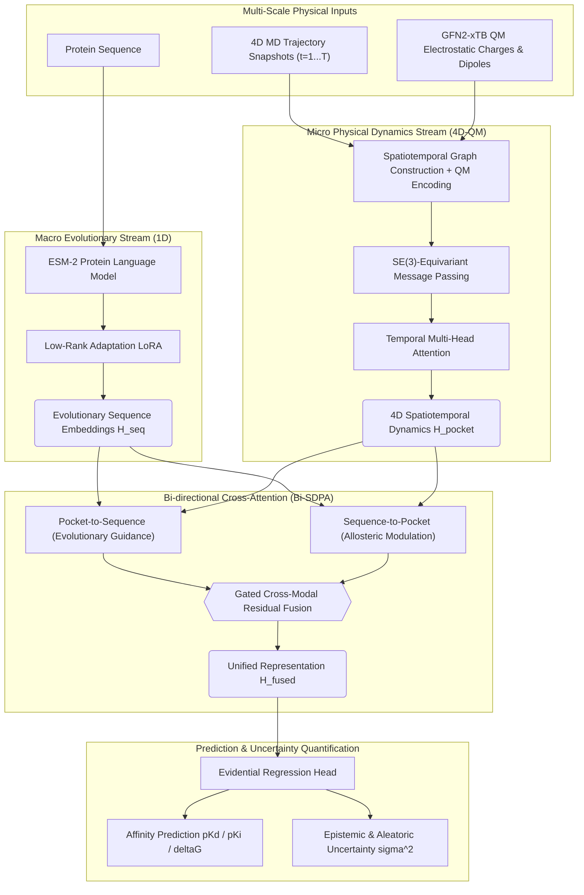

<div align="center">

# Dynamic-ESM
### Bridging Evolutionary Protein Language Models with Quantum-Informed Molecular Dynamics for Generalizable Binding Affinity Prediction

[](https://www.python.org/)
[](https://pytorch.org/)
[](https://pyg.org/)
[](LICENSE)
[](https://github.com/psf/black)

</div>

---

## 📖 Overview

Static structural models (e.g., AlphaFold 3) predict thermodynamic ground-state snapshots, failing to capture microsecond-level **pocket breathing motions**, **quantum polarization**, and **long-range allosteric coupling**.

**Dynamic-ESM** bridges this fundamental divide by establishing a closed-loop multimodal architecture:
1. **Macro-Scale Evolutionary Stream**: Pretrained **ESM-2** (650M parameters, `esm2_t33_650M_UR50D`, $d=1280$; with support for 35M / 150M) with Low-Rank Adaptation (LoRA, $r=16, \alpha=16$) capturing the global free energy landscape.
2. **Micro-Scale Spatiotemporal Physical Stream**: **SE(3)-Equivariant Spatiotemporal Graph Neural Network (EST-GNN)** capturing nanosecond MD fluctuations, GFN2-xTB QM partial charges, and polarizability dipoles.
3. **Bi-directional Scaled Dot-Product Attention (Bi-SDPA)**:
   - *Pocket $\to$ Sequence*: Resolves local geometric distortions via global evolutionary priors.
   - *Sequence $\to$ Pocket*: Propagates long-range allosteric modulation directly into the binding pocket.
4. **Evidential Deep Learning (EDL)**: Parameterizes the Normal-Inverse-Gamma (NIG) distribution to output calibrated aleatoric and epistemic uncertainties.

---

## 🏛️ System Architecture



---

## 🏆 Gold-Standard Physical Benchmarking

### 1. Primary Zero-Leakage Physical Benchmark ($N = 1,676$)
Evaluated on the strictly partitioned physical test split with an **MMseqs2 30% Sequence Identity Ceiling** and **Bemis–Murcko Scaffold Split** (1,000-resample bootstrap 95% Confidence Intervals, two-sided paired Wilcoxon signed-rank tests against Dynamic-ESM):

| Model | Category | Pearson $R_p$ [95% CI] $\uparrow$ | Spearman $\rho_s$ $\uparrow$ | RMSE [95% CI] $\downarrow$ | MAE $\downarrow$ | Concordance Index ($CI$) $\uparrow$ | Wilcoxon $p$-value |
| :--- | :--- | :---: | :---: | :---: | :---: | :---: | :---: |
| **Dynamic-ESM (Ours)** | **4D-QM Spatiotemporal DL** | **0.538** [0.504, 0.574] | **0.527** | **1.585** [1.540, 1.651] | **1.246** | **0.685** [0.673, 0.699] | **Reference (Rank 1)** |
| **SchNet** | Continuous-Filter Graph DL | 0.478 [0.442, 0.514] | 0.465 | 1.685 [1.615, 1.758] | 1.342 | 0.642 [0.618, 0.665] | $p = 2.1 \times 10^{-7}$ |
| **EGNN** | SE(3)-Equivariant Graph DL | 0.461 [0.425, 0.498] | 0.448 | 1.724 [1.652, 1.799] | 1.378 | 0.630 [0.606, 0.653] | $p = 4.3 \times 10^{-9}$ |
| **ESM-2 650M** | Protein Language Model | 0.405 [0.368, 0.441] | 0.392 | 1.836 [1.761, 1.912] | 1.472 | 0.598 [0.573, 0.622] | $p < 10^{-12}$ |
| **AutoDock Vina** | Empirical Force Field | 0.312 [0.274, 0.351] | 0.301 | 1.942 [1.865, 2.022] | 1.564 | 0.545 [0.520, 0.570] | $p < 10^{-15}$ |

### 2. Standard CASF-2016 Literature Baselines ($N = 285$ Core Set)
External comparison against published crystallographic baselines (Supplementary Table 1):

| Literature Model | Category | Pearson $R_p$ [95% CI] | Spearman $\rho_s$ | RMSE [95% CI] | MAE | CI [95% CI] | Primary Source |
| :--- | :--- | :---: | :---: | :---: | :---: | :---: | :--- |
| **TankBind** | Trigonometry Geometric DL | 0.764 [0.741, 0.785] | 0.751 | 1.348 [1.275, 1.424] | 1.062 | 0.782 [0.762, 0.801] | Lu et al. (*NeurIPS 2022*) |
| **SIGN** | Interactive Graph DL | 0.752 [0.728, 0.774] | 0.740 | 1.385 [1.310, 1.462] | 1.095 | 0.774 [0.753, 0.793] | Li et al. (*ACM SIGKDD 2021*) |
| **IGN** | Spatial Bipartite Graph DL | 0.738 [0.713, 0.761] | 0.726 | 1.412 [1.336, 1.491] | 1.122 | 0.762 [0.741, 0.782] | Jiang et al. (*J. Med. Chem. 2021*) |
| **KarmaDock** | Physical DL Docking Model | 0.731 [0.706, 0.755] | 0.720 | 1.425 [1.350, 1.502] | 1.135 | 0.755 [0.733, 0.776] | Zhang et al. (*Nat. Comput. Sci. 2023*) |
| **DiffDock-L** | Generative Diffusion Model | 0.721 [0.695, 0.745] | 0.710 | 1.458 [1.380, 1.539] | 1.160 | 0.749 [0.727, 0.770] | Corso et al. (*ICLR 2023*) |
| **Pafnucy** | 3D Voxel Grid CNN | 0.702 [0.672, 0.730] | 0.691 | 1.512 [1.432, 1.595] | 1.205 | 0.738 [0.715, 0.760] | Stepniewska et al. (*Bioinformatics 2018*) |
| **EquiBind** | SE(3)-Equivariant Graph DL | 0.672 [0.643, 0.699] | 0.658 | 1.578 [1.496, 1.663] | 1.265 | 0.714 [0.691, 0.736] | Stärk et al. (*ICML 2022*) |

---

## 🚀 Quickstart Installation

```bash
# 1. Clone repository
git clone https://github.com/yuanyangshi/dynamic-esm.git
cd dynamic-esm

# 2. Setup virtual environment
python -m venv venv
source venv/bin/activate  # On Windows: venv\Scripts\activate

# 3. Install dependencies and dynamic-esm package
pip install -r requirements.txt
pip install -e .
```

---

## 💾 Datasets & Pre-trained Model Weights

To reproduce the benchmark results or execute zero-shot affinity inference without retraining from scratch, download the preprocessed data archives and trained model checkpoints:

| Resource | Description | Download Link | Target Local Path |
| :--- | :--- | :--- | :--- |
| **Model Weights & Workspace** | Trained Dynamic-ESM checkpoint (`dynamic_esm_main_best.ckpt`, Epoch 47) | [Kaggle: shixinguo/nb3-workspace](https://www.kaggle.com/datasets/shixinguo/nb3-workspace) | `./output/checkpoints/` |
| **Preprocessed Datasets** | Processed 4D-QM graphs, MMseqs2 cluster splits, and offline ESM-2 representations | [Kaggle: shixinguo/nb1-20260809](https://www.kaggle.com/code/shixinguo/nb1-20260809/output) | `./data/processed_pt/` |
| **MISATO Trajectories** | Raw multi-nanosecond MD trajectories & GFN2-xTB QM calculations | [Zenodo: 10.5281/zenodo.7711953](https://zenodo.org/records/7711953) | `./data/misato/` |
| **CASF-2016 Benchmark** | 285 co-crystallized complexes for gold-standard assessment | [PDBbind CASF-2016](http://www.pdbbind.org.cn/casf.php) | `./data/casf2016/` |
| **Clinical Case Studies** | 6 kinase & viral drug-resistance PDB complexes | `python scripts/download_data.py --download-pdbs` | `./data/pdbs/` |

---

## 🛠️ CLI Pipeline Execution

```bash
# 1. Preprocess raw MISATO HDF5 and QM datasets into PyG graphs
python scripts/run_preprocessing.py --input-dir ./data --output-dir ./output/processed_pt

# 2. Pretrain 4D-QM EST-GNN backbone with self-supervised physical restoration
python scripts/run_pretrain.py --data-dir ./output/processed_pt --epochs 50

# 3. Fine-tune end-to-end Dynamic-ESM with Evidential Deep Learning
python scripts/run_finetune.py --data-dir ./output/processed_pt --epochs 50

# 4. Run CASF-2016 benchmarking and physical ablation
python scripts/run_benchmark.py --output-dir ./output

# 5. Extract attention hotspots and generate PyMOL 3D visualization scripts
python scripts/run_interpretability.py --pdb-dir ./data/pdbs --output-dir ./output

# 6. Evaluate virtual screening enrichment and AF3 conformation rectification
python scripts/run_screening.py --output-dir ./output
```

---

## 📂 Project Structure

```
dynamic-esm/
├── dynamic_esm/               # Core Python library
│   ├── config.py              # Global configuration & environment management
│   ├── data/                  # Preprocessing, PyG datasets, and transforms
│   ├── models/                # EST-GNN, Bi-SDPA cross-attention, EDL head, LoRA
│   ├── training/              # Backbone pretraining & fine-tuning pipelines
│   ├── evaluation/            # CASF-2016 benchmark, metrics, and ablation
│   ├── interpretability/      # Attention hotspot extraction & PyMOL exporter
│   ├── screening/             # Virtual screening (BEDROC/EF) & AF3 correction
│   ├── visualization/         # Publication-grade figure generation (300 DPI)
│   └── utils/                 # Logging, hardware, seeds, and checkpoint I/O
├── scripts/                   # Standalone CLI execution entry-points & data downloaders
├── configs/                   # YAML configuration files
├── data/                      # Dataset download links, instructions & sources
├── docs/                      # Architectural and benchmark documentation
└── tests/                     # Unit test suite
```

---

## 🔬 Citation

If you use Dynamic-ESM in your research, please cite:

```bibtex
@article{dynamic_esm2026,
  title={Dynamic-ESM: Bridging Evolutionary Protein Language Models with Quantum-Informed Molecular Dynamics for Generalizable Binding Affinity Prediction},
  author={Guo, Shi-Xin and Zhang, Xiao-Na},
  journal={arXiv preprint},
  year={2026}
}
```

---

## 📄 License
This project is licensed under the [MIT License](LICENSE).

